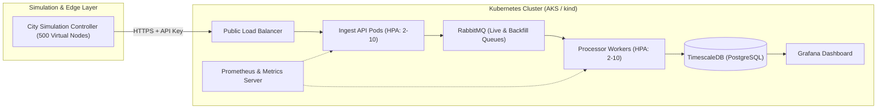

# Cloud-Native IoT Telemetry & Auto-Scaling Engine

> **A containerized, elastic edge-to-cloud architecture deployed on Docker, Kubernetes (AKS/kind), and Cloud Infrastructure.**

---

## 1. Case Study: City-Wide Seismic & Structural Monitoring

This project simulates a metropolitan network of **500 virtual seismic sensor stations** deployed across 5 urban sectors (Downtown, Industrial, Residential, Transit, and Suburbs). 

Under normal conditions, sensor nodes sample at 1,000 Hz locally and emit lightweight 60-second summary telemetry. When ground acceleration crosses a seismic threshold (earthquake or structural shock), nodes automatically switch into **high-resolution raw waveform mode**, flooding the ingestion pipeline with burst traffic.

The system uses **Kubernetes Horizontal Pod Autoscaling (HPA)**, **RabbitMQ message buffering**, and **TimescaleDB** time-series storage to dynamically scale compute from 2 to 10 replicas, absorb burst spikes without dropping telemetry, and self-heal failed pods with zero downtime.

---

## 2. Architecture & Data Flow



---

## 3. Team Responsibilities

| Track | Owner | Scope & Deliverables | Cloud Credit Required? |
| :--- | :--- | :--- | :--- |
| **Local Track** | **Local Owner** | Fleet simulator (500 nodes), interactive city dashboard, Ingest API, Processor microservice, RabbitMQ & TimescaleDB setup, local Kubernetes (`kind`), and HPA stress testing. | **No** (Runs locally) |
| **Azure Track** | **Azure Owner** | Azure account & AKS cluster management, Dockerfiles, Docker Compose, unit tests, CI/CD with GitHub Actions, Prometheus/Grafana, cloud rollout, and cost control. | **Yes** (Azure for Students) |

---

## 4. Repository Structure

```text
├── docs/                             # Architecture, contracts, and case study docs
│   ├── api_contract.md               # Ingest API specifications (endpoints, codes, headers)
│   ├── case_study.md                 # Seismic monitoring scenario & problem statement
│   └── city_simulation_dashboard.md  # 500-node virtual city dashboard specifications
├── schemas/                          # Data schemas & payload contracts
│   └── telemetry_schema.json         # JSON Schema for summary and waveform batches
├── simulator/                        # 500-node Python asyncio simulator & web UI
├── services/                         # Microservices source code
│   ├── ingest-api/                   # FastAPI ingestion service
│   └── processor/                    # RabbitMQ consumer & calculation engine
├── k8s/                              # Kubernetes manifests (Deployments, Services, HPA)
└── scripts/                          # DB migrations, local setup, and test scripts
```

---

## 5. Working Rules & Git Workflow (Contributing)

To ensure seamless collaboration between both team tracks:

1. **Branch per Task:** Never commit directly to `main`. Create a feature branch for every task (e.g., `feat/l4-virtual-generator`, `feat/z6-ingest-dockerfile`).
2. **Pull Requests & Code Reviews:** Every branch merged into `main` must go through a GitHub Pull Request (PR) and be reviewed by the other team member.
3. **Commit Messages:** Use clear conventional commit prefixes:
   * `feat: ...` for new features or implementations.
   * `fix: ...` for bug fixes.
   * `docs: ...` for documentation and contracts.
   * `k8s: ...` for Kubernetes manifests and configurations.
4. **Handoff Milestones:**
   * **Week 1:** Message schema & API contract handed to Azure owner for test design.
   * **Week 2:** Ingest API & Processor code handed over for Docker packaging.
   * **Week 3:** Local Kubernetes manifests handed over for AKS deployment.
